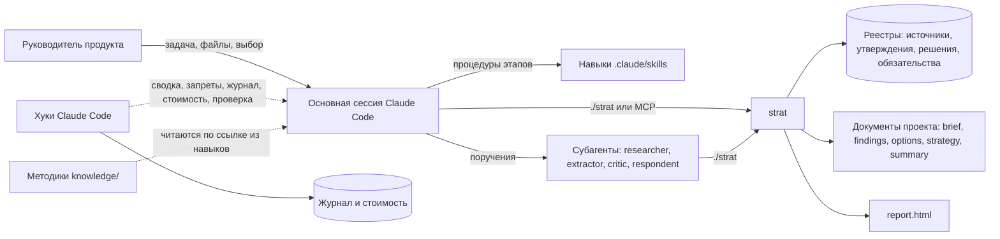

# Архитектура агента «Стратег»

## Принцип

Агент — это Claude Code в папке репозитория плюс четыре вещи: правила (`AGENTS.md`), процедуры этапов (навыки), помощники для отдельных задач (субагенты) и детерминированный инструмент `strat`, который хранит доказательную базу и состояние в файлах. Модель решает, что делать дальше и как писать; `strat` и хуки отвечают за то, что нельзя доверять одной модели: проверку цитат, разделение фактов и гипотез, журнал, стоимость и запреты.

## Компоненты и зачем каждый нужен

| Компонент | Что делает | Почему не обойтись без него |
|---|---|---|
| `AGENTS.md` + `CLAUDE.md` | правила, процесс, маршрутизация, карта инструментов | единственный текст, который модель видит всегда; около 3–4 тыс. токенов |
| 15 навыков | процедура каждого этапа | в контексте постоянно только их описания (≈1,3 тыс. токенов), тело навыка подгружается, когда этап начинается; если бы все процедуры лежали в одной инструкции, постоянная часть контекста выросла бы примерно с 4 до 11 тыс. токенов на каждом ходе |
| `researcher` (Sonnet) | один вопрос плана: поиск, снимки, записи | длинные веб-страницы остаются в контексте субагента, в основную сессию возвращается 10–15 строк; вопросы идут параллельно |
| `extractor` (Haiku) | перенос утверждений из документов в реестр | механическая работа на модели в 40 раз дешевле Opus по входным токенам; ошибки ловит сверка цитат |
| `critic` (Opus) | сильные возражения, pre-mortem, согласованность стратегий | не видел рассуждений основной сессии, поэтому не подыгрывает; один-два вызова на проект |
| `respondent` (Sonnet) | модельный респондент | без доступа к файлам и без `AGENTS.md`: знает только карточку персоны и вопросы, не может подстроиться под гипотезы |
| `strat` (Python, без зависимостей) | реестры, снимки, сверка цитат, проверки документов, состояние, анализ влияния, поиск, решения, стоимость, отчёт, MCP | то, что должно работать одинаково каждый раз и проверяться тестами |
| 6 хуков + строка статуса | сводка при старте, запреты, журнал, сигнал об инъекциях, стоимость, проверка перед концом хода | правила в тексте модель может забыть; хук срабатывает всегда |
| MCP-сервер `strat` | те же функции как типизированные инструменты | Cursor, Codex и другие среды без хуков и навыков Claude Code; в Claude Code — вызов без экранирования кавычек |

## Рабочий процесс

Типы процесса выбираются на входе (навык `strateg`) и записываются в состояние с причиной:

| Процесс | Этапы |
|---|---|
| `full` | постановка → материалы → исследование → варианты → стратегия → отчёт → решение → сопровождение |
| `quick` | постановка → исследование → отчёт |
| `comms` | как `full` до отчёта, акцент на барьерах и сообщении |
| `diagnostic` | как `full` до решения, исследование по `knowledge/diagnostics.md` |
| `revisit` | сопровождение: пересмотр по новым данным |

Этап начинается командой `./strat stage <этап> start` (копирует шаблоны документов) и закрывается `./strat stage <этап> done`. Закрытие запускает проверку документов этапа; при ошибках этап не закрывается (принудительное закрытие возможно, но пишется в журнал).

Человек участвует в четырёх точках: подтверждает рамку, одобряет дорогое исследование, выбирает вариант, называет ответственных и сроки. Вопросы задаются через AskUserQuestion с вариантами и записываются в состояние (`./strat ask`, `./strat answer`), поэтому видно, какие решения принимал человек.

## Контекст и знания: четыре слоя

| Слой | Где | Кто меняет | Как попадает в контекст |
|---|---|---|---|
| Постоянные инструкции | `AGENTS.md`, `CLAUDE.md`, `.claude/skills`, `.claude/agents` | команда агента | правила — всегда; навыки — по необходимости |
| Методические знания | `knowledge/*.md` | команда агента | по ссылке из навыка |
| Материалы проекта | `projects/<имя>/inputs`, `sources/` (снимки и реестр) | агент через `strat`, руководитель | по запросу: `./strat source show`, `./strat search` |
| Состояние задачи | `state.json`, `evidence/claims.jsonl`, документы этапов, `log/` | агент через `strat` | сводка хуком при старте сессии и после сжатия контекста |

## Реестр утверждений

Запись (`evidence/claims.jsonl`): текст, тип, источники, дословная цитата, место в источнике, основания (для выводов), метод (для оценок), уверенность, дата актуальности и срок годности, метки, статус (действует, оспорено, отозвано, заменено), история изменений, кто добавил, найдена ли цитата в снимке.

Источник (`sources/registry.jsonl`): тип, адрес или имя файла, хэш, дата получения, дата публикации, издатель, надёжность A–D, флаги (например, найден текст, обращённый к ИИ) и снимок текста в `sources/snapshots/S-…md`. Снимок нужен, чтобы проверка цитат и чтение источника не зависели от того, изменится ли страница завтра.

Связи: запись → источники; вывод → основания; документ → записи (по ссылкам `[C-…]`); решение → основания. По этому графу работают:
- `./strat impact C-…|S-…` — какие выводы, разделы документов и решения затронуты изменением (с транзитивными выводами);
- `./strat search` — поиск по записям, источникам и разделам документов (BM25 со стеммингом русского и английского, `--all` — по всем проектам, `--links` — связи найденной записи);
- `./strat decision check` — решения, чьи основания оспорены, отозваны или устарели.

Память между сессиями — это и есть реестр. Прошлый вывод агента хранится как `inference` со ссылками на основания и не может стать фактом: проверка документов не примет пункт в разделе фактов, если он опирается только на выводы, гипотезы или синтетику. Исправление и отзыв — командами `claim update`, `dispute`, `retract`, `supersede` с историей.

## Проверки документов (`./strat lint`)

| Код | Что проверяет | Когда блокирует |
|---|---|---|
| E101 | ссылка на несуществующую запись или источник | всегда (и хук перед концом хода) |
| E102 | ссылка на отозванную или заменённую запись | всегда |
| E104 | синтетический ответ вне разделов гипотез | всегда |
| E105 | пункт в разделе фактов без ссылки | всегда |
| E106 | пункт в разделе фактов опирается только на гипотезы, прогнозы, выводы | всегда |
| E201, E211 | нет обязательного раздела или он пуст | при закрытии этапа |
| E202, E203, E205, E206 | меньше трёх вариантов, нет статус-кво, нет возражений, нет фактов или гипотез у варианта | при закрытии этапа |
| E208–E210 | нет аудита обещаний, обещание без привязки к продукту, обещание со статусом «нет» | при закрытии этапа |
| W1xx, W2xx | оспоренные и устаревшие записи, непроверенные цитаты, факты только из источников уровня D, нет варианта «закрыть» | предупреждение |

## Продолжение после перерыва и повторы

- Состояние процесса — `state.json`: этап, статусы этапов и шагов, вопросы руководителю и ответы, следующий шаг, лимит бюджета.
- При старте сессии (и после сжатия контекста) хук `SessionStart` присылает сводку: где остановились, незавершённые шаги, вопросы без ответа, сроки решений, ошибки проверки.
- Шаги идемпотентны: `./strat step <id> start` для выполненного шага возвращает код 3, и агент его пропускает. Источник с тем же адресом или файлом не добавляется второй раз, одинаковая запись в реестре тоже.
- Всё состояние в файлах проекта, поэтому продолжить можно в новом чате, на другом компьютере (через git) или в другой среде.

## Маршрутизация

- Процесс: по типу запроса (таблица в навыке `strateg`), с записью причины. Ошибочный выбор исправляется переключением (`./strat workflow`), например когда справка упирается в выбор вариантов.
- Модель: по задаче и цене (таблица компонентов выше). Основная сессия модель не меняет: переключение модели сбрасывает кэш контекста и дорожает.
- Исправление ошибочного выбора модели: если после `extractor` не найдено больше 20% цитат или есть ошибки проверки в его записях, извлечение повторяет `researcher`.
- Инструмент: `source fetch` → при отказе сайта WebFetch и `source note` → PDF и изображения через Read → таблицы через `data profile` и скрипт.

## Сбои

- Ошибки инструментов записываются хуком `PostToolUseFailure`; агенту подсказывается запасной путь, а повтор ограничен одним разом.
- `strat` пишет файлы атомарно (временный файл и замена) и берёт блокировку на реестры, поэтому параллельные субагенты не портят данные.
- Хуки не роняют работу: внутренняя ошибка хука пишется в `log/hook_errors.log`, а `./strat doctor` её показывает.

## Прозрачность и стоимость

- Журнал `log/journal.jsonl`: каждое обращение к инструменту (поисковый запрос, адрес, команда, файл), действия `strat`, сбои, срабатывания запретов, сообщения руководителя.
- Стоимость `log/costs.jsonl`: после каждого ответа хук `Stop` читает журнал сессии Claude Code (основная сессия и субагенты), убирает повторные записи одного ответа и считает приращение по тарифам из `config/prices.json` с привязкой к текущему этапу. Оценку Claude Code из строки статуса хранит рядом для сверки.
- Отчёт (`report.html`) содержит приложение «Как получен результат»: этапы и их длительность, источники по уровням надёжности, сколько цитат сверено, вызовы инструментов, сбои, вопросы человеку и ответы, стоимость, итог проверки документов.

## Безопасность

- Политика источников (`config/policy.json`) применяется дважды: хук перед WebFetch и сама команда `source fetch`, включая адрес после переадресации.
- Инъекции: снимки и ответы WebFetch проверяются на текст, обращённый к ИИ; источник получает флаг, агент получает уведомление, правило в `AGENTS.md` запрещает выполнять такие указания.
- Секреты: хук не даёт записать в файлы текст, похожий на ключи и пароли.
- Персональные данные: расшифровки интервью регистрируются только обезличенными.
- Целостность: реестры, снимки, состояние и журналы защищены от ручной правки и правки через оболочку.

## Где лежат ключевые инструкции

- Роль, правила и маршрутизация: `AGENTS.md`; особенности Claude Code: `CLAUDE.md`.
- Процедуры этапов: `.claude/skills/<навык>/SKILL.md`.
- Субагенты: `.claude/agents/researcher.md`, `extractor.md`, `critic.md`, `respondent.md`.
- Методики: `knowledge/`.
- Хуки и права: `.claude/settings.json`; логика хуков: `tools/stratlib/hooks.py`; проверки документов: `tools/stratlib/lint.py`.
